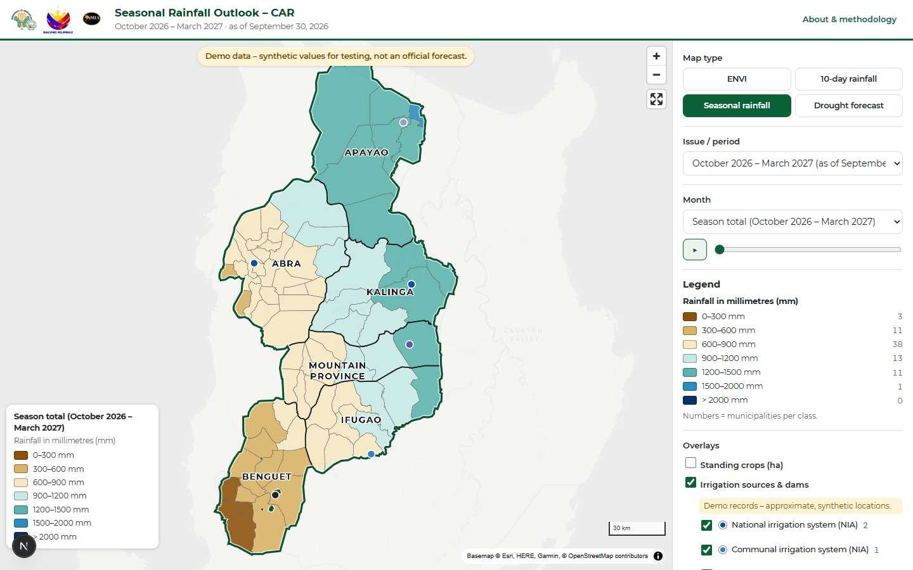

# CAR Agri-Climate Portal

The CAR Agri-Climate Portal is a web system for the Department of Agriculture – Regional Field Office, Cordillera
Administrative Region (DA-RFO-CAR), AMIA Program. It has two parts:

- **Public dashboard:** published maps of the El Niño Vulnerability Index (ENVI), the 10-day and seasonal rainfall
  forecasts (mm) and the drought forecast for the 77 municipalities of CAR. It has crop and irrigation overlays,
  an archive, downloads and share links.
- **Admin workspace:** upload → validate → preview → edit text → generate print-ready exports → publish.
  - The ENVI exposure indicator covers rice, corn, high-value crops (computed from the HVCDP Regional Summary for the
    standing-crops date) and, optionally, livestock & poultry (heads → livestock units, combined after normalization).
  - Exports are the map images (PNG, no PDFs): every rainfall and drought map gets a print-ready PNG (400 dpi), with a
    title page first and a summary page and a recommendations page last, plus one ZIP of all of them. ENVI gets, for the season outlook and each month, a landscape presentation (5760×3240) and a
    portrait A4 poster (450 dpi) as PNG images, plus the computation Excel in the ZIP. Standing crops can be added as proportional circles
    (seasonal rainfall, drought and ENVI), with a circle legend.
  - Print maps follow the DA-RFO-CAR sample layouts in `sample data/`. The 10-day forecast has one map per
    day; seasonal rainfall one map per month (there are no 10-day or season total maps).
- **El Niño Action Plan Dashboard:** the El Niño activities of DA and its partners in each municipality (to
  conduct, ongoing, completed, postponed) next to the municipalities at risk on the latest ENVI map, with large
  figures and charts. Staff enter activities by hand or import them from Excel.
- **Special Farm Weather Outlook and Advisory (tropical cyclone):** made from the latest PAGASA Tropical Cyclone
  Bulletin, with the CAR municipalities under each wind signal on a map, PAGASA's track forecast image and a farm
  advisory, exported as A4 pages and Facebook posts.
- **Photo mode** on the dashboard shows the finished map images with the recommendations (the infographic for
  ENVI).



| Document | Contents |
|---|---|
| [docs/ARCHITECTURE.md](docs/ARCHITECTURE.md) | Architecture, data model, screens, answers to §12, milestone status |
| [docs/ADMIN_GUIDE.md](docs/ADMIN_GUIDE.md) | Step-by-step guide for editors and administrators |
| [docs/ENVI_RESEARCH_PAPER.html](docs/ENVI_RESEARCH_PAPER.html) | ENVI technical paper (weights 70/15/15): method, HVC and livestock exposure, Oct 2026 – Mar 2027 results, sensitivity, limitations |
| [PROMPT_CAR_AgriClimate_Portal.md](PROMPT_CAR_AgriClimate_Portal.md) | The original requirements |

## Repository layout

```
web/        Next.js 15 + TypeScript + MapLibre GL – dashboard, admin workspace, API routes (deploy: Vercel)
worker/     Python FastAPI render worker – validation, products, exports (deploy: Docker, python:3.13-slim)
  agriclimate/envi/     the ENVI prototype (Elnino-vul-index), ported unchanged apart from paths;
                        exposure.py adds the HVC (HVCDP Regional Summary) and livestock inputs
  agriclimate/products/ ENVI, 10-day rainfall, seasonal rainfall, drought, crops and irrigation layers
  agriclimate/rainfall_feed.py   10-day rainfall feed (Cordillera weather API)
  agriclimate/pagasa_seasonal.py seasonal rainfall from PAGASA's published tables (CAR rows, OCR)
  agriclimate/droughtcaster.py   CAR drought outlook from PAGASA DroughtCaster (+ manual upload fallback)
  data/gis, data/gis_template    CAR boundaries (EPSG:4326) and the DA QGIS print templates
                                 (+ ne_countries_region.geojson: Natural Earth 1:50m countries, public domain,
                                 for the tropical cyclone track map)
  scripts/              build_reference, build_glyphs, build_seed_sql, build_demo, make_demo_samples
supabase/   migrations/0001_init.sql (PostGIS schema + RLS + storage buckets), seed.sql
sample data/sample input/        DA-RFO-CAR sample inputs (ENVI, incl. HVCDP Regional Summary and livestock inventory)
docs/       architecture, admin guide, screenshots
```

## Run it locally

Requirements:
- Python 3.11+ and Node 20+.
- **PostgreSQL 17** installed (default `C:/Program Files/PostgreSQL/17`; set `PG_HOME` otherwise). It is used
  only for its binaries; the installed service and its password are not touched.
- Optional: QGIS 3.x, so ENVI maps are rendered with the official `.qgz` layout.

**1. Local database (PostgreSQL + PostGIS)**

```bash
cd web
npm install
npm run db:setup     # once: portable copy of PostgreSQL 17 + PostGIS 3.6 in <repo>/.localdb (no admin rights)
npm run db:start     # runs on localhost:54329 (stop with npm run db:stop)
npm run db:reset     # schema + seed (77 municipalities, boundaries, legends) + demo products + admin user
```

`db:reset` loads the same `supabase/migrations` and `supabase/seed.sql` that production uses.
`supabase/local/compat.sql` stands in for Supabase's `auth`/`storage` schemas.

**Admin login:** `DEV_ADMIN_EMAIL` / `DEV_ADMIN_PASSWORD` in `web/.env.local` (password 8+ characters). `node dev.mjs`
creates or updates this admin in the local database on every start and prints it, so it is the one login to use.
(`db:reset` on its own creates admin@example.com / admin-local-123, or `LOCALDB_ADMIN_EMAIL` / `LOCALDB_ADMIN_PASSWORD`.)

- Add more users with `npm run db:user -- someone@da.gov.ph <password> editor` (or `admin`).
- **Sample activities (development only):** `db:reset` and `node dev.mjs` (when the list is empty) add about 80
  made-up activities, tagged `sample (dev)`, so the El Niño Action Plan Dashboard has something to show. Remove them with
  `node scripts/localdb.mjs activities-demo --clear`, or make a fresh set with `node scripts/localdb.mjs activities-demo`.
  They are never in the migrations or `seed.sql`, so production never gets them.
- Open psql with the command printed by `node scripts/localdb.mjs psql`.
- Run `db:reset` again whenever you want a clean database.
- After pulling changes that add database migrations, run `npm run db:migrate` (`node dev.mjs` does it for you).
- After rebuilding the demo (`python -m scripts.build_demo`), run `npm run db:demo`. It refreshes only the demo
  products and keeps your own work.

**2. Worker**

```bash
cd worker
python -m venv .venv
.venv/Scripts/python -m pip install -r requirements.txt        # Windows (Linux/macOS: .venv/bin/python)
set WORKER_TOKEN=dev-worker-token-1234567890                    # PowerShell: $env:WORKER_TOKEN="..."
.venv/Scripts/python -m uvicorn agriclimate.api:app --port 8001
```

**3. Web**

```bash
cd web
copy .env.example .env.local     # keep DATABASE_URL, set WORKER_TOKEN (same as above) and a 32+ character SESSION_SECRET
npm run dev                      # http://localhost:3000 – admin at /admin
```

**Day to day: one command** (from the repo root, after the one-time steps above):

```bash
node dev.mjs        # starts the database (if needed), the worker (:8001) and the web app (:3000); Ctrl+C stops them
```

The web app picks its data back end from the environment:

| Back end | When | Data | Logins |
|---|---|---|---|
| Supabase | `NEXT_PUBLIC_SUPABASE_*` set | Supabase Postgres + Storage | Supabase Auth |
| PostgreSQL | `DATABASE_URL` set | local (or self-hosted) PostgreSQL + PostGIS; files in `web/.data/` | users in the database (scrypt hashes, roles in `profiles`) |
| Files | neither | bundled demo data + `web/.data/db.json` | one admin from `DEV_ADMIN_*` (development only) |

> **Demo data.** ENVI and drought use the DA-RFO-CAR sample inputs. The 10-day rainfall is a real snapshot of the
> feed (Oct 5–14, 2026). The **seasonal rainfall and irrigation demo data are synthetic**, and the dashboard says so
> in a banner. Rebuild the demo with `python -m scripts.build_demo` (in `worker/`), then `npm run db:reset`.

## Tests

```bash
cd worker && .venv/Scripts/python -m pytest      # name matching (77 names + variants), normalization, weights,
                                                  # equal/quantile/Jenks, rainfall classes at the breaks, templates,
                                                  # label report (83 labels, 0 overlaps), API, feed, ENVI acceptance
cd web && npm test                                # share links, formatting, crop classes
cd web && npm run typecheck
# end-to-end, one run per product (worker + web running):
cd web && E2E_EMAIL=admin@example.com E2E_PASSWORD=admin-local-123 node scripts/e2e.mjs
```

## Environment variables

**web/** (Vercel → Project → Settings → Environment Variables)

| Variable | Needed | Purpose |
|---|---|---|
| `NEXT_PUBLIC_SUPABASE_URL`, `NEXT_PUBLIC_SUPABASE_ANON_KEY` (or `NEXT_PUBLIC_SUPABASE_PUBLISHABLE_KEY`) | production | Supabase project (public read through RLS) |
| `SUPABASE_SERVICE_ROLE_KEY` | production | Server-only writes after the role check. Never exposed to the browser. |
| `WORKER_URL`, `WORKER_TOKEN` | yes | Private render worker URL and shared secret |
| `SESSION_SECRET` | yes | 32+ characters; signs preview payloads (and local sessions) |
| `CRON_SECRET` | production | Protects `/api/cron/rainfall-feed` and `/api/cron/tc-advisory` (Vercel Cron sends it). The automatic Special Advisory runs at 3, 15 and 30 minutes past 21:00, 03:00, 09:00 and 15:00 UTC (5 AM / 11 AM / 5 PM / 11 PM in Manila): this needs Vercel Pro (Hobby allows one cron run a day) – or let another scheduler call it with `Authorization: Bearer $CRON_SECRET` |
| `R2_ACCOUNT_ID`, `R2_ACCESS_KEY_ID`, `R2_SECRET_ACCESS_KEY` | optional | Cloudflare R2 file storage instead of Supabase Storage (uploads, exports) |
| `R2_BUCKET`, `R2_PUBLIC_BUCKET`, `R2_PUBLIC_URL` | with R2 | Private bucket (default `amia-car-maps`), public bucket (default `amia-car-maps-public`, public access on) and its public URL. Published files are linked to the public bucket only when `R2_PUBLIC_URL` is a **custom domain**; with an `*.r2.dev` address (blocked on some networks) or none, they are served through the app (`/api/exports/…`: previews streamed and cached, big files via 5-minute signed links) |
| `DATABASE_URL` | local / self-hosted | PostgreSQL + PostGIS instead of Supabase (e.g. the local dev database) |
| `DEV_ADMIN_EMAIL`, `DEV_ADMIN_PASSWORD` | local development | The admin login: set in the local database by `node dev.mjs`, or the single login without any database |

**worker/**

| Variable | Needed | Purpose |
|---|---|---|
| `WORKER_TOKEN` | yes | Same value as in web |
| `SUPABASE_URL`, `SUPABASE_SERVICE_ROLE_KEY` | production | Upload exports to the private `exports` bucket |
| `R2_ACCOUNT_ID`, `R2_ACCESS_KEY_ID`, `R2_SECRET_ACCESS_KEY`, `R2_BUCKET` | optional | Upload exports to Cloudflare R2 (`exports/<version>/…`) instead of Supabase Storage |
| `EXPORTS_BUCKET` | no | Default `exports` |
| `OUTPUT_DIR` | no | Working folder for jobs (default `worker/outputs`) |
| `RAINFALL_FEED_URL` | no | Default `https://cordillera-weather.onrender.com/api/cordillera/full/` |
| `DROUGHTCASTER_URL` | no | A table in the drought template format at this URL, instead of PAGASA DroughtCaster (default: the DroughtCaster site's data endpoint) |
| `DROUGHTCASTER_API` | no | Default `https://droughtcaster.pagasa.dost.gov.ph/proxy.php` (the site's JSON endpoint, read per CAR province) |
| `PAGASA_SEASONAL_URL` | no | Default `https://www.pagasa.dost.gov.ph/climate/climate-prediction/seasonal-forecast` (seasonal forecast tables, read with OCR) |
| `QGIS_PYTHON` | no | PyQGIS launcher, if QGIS is not found automatically |

## Deployment

1. **Database (Supabase).**
   - Create a project.
   - Run the migrations in order (`supabase/migrations/0001_init.sql`, `0002_crop_colors.sql`), then
     `supabase/seed.sql` (SQL editor, or `supabase db push`).
     PostGIS must be enabled.
   - Create the staff users in Auth.
   - For each user, insert a `profiles` row with role `editor` or `admin`.
2. **Worker (container host).**
   - Build the image: `docker build -t amia-car-maps-worker worker/`.
   - Run it on Cloud Run, Render, Fly or a VPS with `WORKER_TOKEN`, `SUPABASE_URL` and
     `SUPABASE_SERVICE_ROLE_KEY`.
   - Give it at least 2 GB of RAM and keep it private (only the web app calls it).
   - The image is `python:3.13-slim` with Montserrat installed; maps are drawn with matplotlib (QGIS is not needed).
3. **Web (Vercel).**
   - Import the repository with **Root Directory = `web`** and set the variables above.
   - `vercel.json` schedules the daily rainfall-feed job (22:00 UTC = 06:00 Asia/Manila).

Regenerating reference assets after a boundary change (in `worker/`):

```bash
python -m scripts.build_reference   # gazetteer.csv + web/public/geo/*.geojson (checks the 1 MB budget)
python -m scripts.build_seed_sql    # supabase/seed.sql
python -m scripts.build_glyphs      # Montserrat glyphs for map labels (needs scipy)
```

## Credits

Boundaries: DA-RFO-CAR. Forecasts: DOST-PAGASA. 10-day feed: Cordillera weather API. Basemaps: © Esri, HERE,
Garmin, Maxar; © OpenStreetMap contributors; © OpenTopoMap. Font: Montserrat (SIL Open Font License, bundled).
